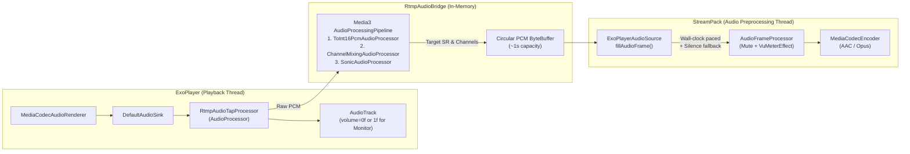

### 1. Why `MediaProjection` Worked (and Why Hooking ExoPlayer Directly Was Hard)

When you use [MediaProjectionAudioSource.kt](file:///Users/dmytroantonov/git/LifeStreamerV2/app/src/main/java/com/dimadesu/lifestreamer/rtmp/audio/MediaProjectionAudioSource.kt) (`AudioPlaybackCapture`), Android's `AudioFlinger` silently handles four critical problems under the hood that a raw ExoPlayer `AudioProcessor` hook does not do by default:

1. **Real-Time Wall-Clock Pacing & Continuous Silence:**
   - StreamPack's [CameraStreamerService.kt](file:///Users/dmytroantonov/git/LifeStreamerV2/app/src/main/java/com/dimadesu/lifestreamer/services/CameraStreamerService.kt#L66-L68) runs `SingleStreamer` in `AudioInputMode.PUSH`, which uses [RawFramePullPush.kt](file:///Users/dmytroantonov/git/LifeStreamerV2/StreamPack/core/src/main/java/io/github/thibaultbee/streampack/core/elements/processing/RawFramePullPush.kt#L71-L103).
   - `RawFramePullPush` runs a tight `while (isActive)` loop with **no sleep**, holding `mutex.withLock` while calling `source.fillAudioFrame(buffer)`. It expects `fillAudioFrame()` to **block** for the exact duration of one audio frame (~20–40 ms):
     - **If `fillAudioFrame()` doesn't block** when buffered data is available: ExoPlayer's `DefaultAudioSink` initially decodes a **burst of ~250–750 ms of audio** in a few milliseconds to fill the empty `AudioTrack` buffer. If `fillAudioFrame()` drains that burst immediately without pacing, it floods [MediaCodecEncoder.kt](file:///Users/dmytroantonov/git/LifeStreamerV2/StreamPack/core/src/main/java/io/github/thibaultbee/streampack/core/elements/encoders/mediacodec/MediaCodecEncoder.kt#L593-L638) (`SyncByteBufferInput`), which uses non-blocking `dequeueInputBuffer(0)` and drops excess bytes (`"Failed to queue input frame: skipping ... bytes"`).
     - **If `fillAudioFrame()` blocks waiting for ExoPlayer** when RTMP is buffering/reconnecting: it holds `RawFramePullPush.mutex`, which **deadlocks** `setInput()` / `removeInput()` when switching sources or stopping the stream, and starves the audio encoder.
     - **If `fillAudioFrame()` throws or returns early** when no data is ready: `RawFramePullPush` spins at 100% CPU in `while (isActive)`.
   - `AudioRecord` + `AudioPlaybackCapture` naturally blocks at the hardware sample rate and outputs clean `0`s (silence) whenever ExoPlayer is paused, buffering, or disconnected.

2. **Automatic Sample Rate & Channel Conversion:**
   - `AudioFlinger` automatically resamples and remixes ExoPlayer's `AudioTrack` (e.g., 48 kHz Stereo from RTMP) into whatever [AudioSourceConfig](file:///Users/dmytroantonov/git/LifeStreamerV2/StreamPack/core/src/main/java/io/github/thibaultbee/streampack/core/elements/sources/audio/AudioSourceConfig.kt) the user configured in LifeStreamer (e.g., 44.1 kHz Mono).

3. **Monotonic Timestamps (`Timebase.UPTIME`):**
   - StreamPack's video surface encoder uses `System.nanoTime() / 1000` (`TimeUtils.currentTime()`). If an ExoPlayer hook returns stream presentation timestamps (which start at 0 or RTMP epoch) instead of `TimeUtils.currentTime()`, the SRT/RTMP muxer sees huge A/V timestamp mismatches.

4. **A Hidden `MediaProjection` Bug on Non-Samsung Devices (`exoPlayer.volume = 0f`):**
   - In [RtmpSourceSwitchHelper.kt](file:///Users/dmytroantonov/git/LifeStreamerV2/app/src/main/java/com/dimadesu/lifestreamer/ui/main/RtmpSourceSwitchHelper.kt#L77), `exoPlayer.volume = 0f` is set so the phone speaker stays silent unless Audio Monitor is enabled ([PreviewViewModel.kt](file:///Users/dmytroantonov/git/LifeStreamerV2/app/src/main/java/com/dimadesu/lifestreamer/ui/main/PreviewViewModel.kt#L2945-L2956)).
   - `exoPlayer.volume = 0f` calls `AudioTrack.setVolume(0f)`. While Samsung OneUI's audio policy happens to let `AudioPlaybackCapture` capture audio before track volume is applied, on many stock Android / Pixel devices `AudioPlaybackCapture` taps the mixer *after* track gain—meaning `volume = 0f` causes `MediaProjection` to capture **pure silence**! Hooking into ExoPlayer directly fixes this too, plus eliminates the `MediaProjection` permission prompt, [MediaProjectionService.kt](file:///Users/dmytroantonov/git/LifeStreamerV2/app/src/main/java/com/dimadesu/lifestreamer/rtmp/audio/MediaProjectionService.kt), and the UID routing race documented in [research-rtmp-src-audio-is-sometimes-missing-after-rtmp-src-restart.md](file:///Users/dmytroantonov/git/LifeStreamerV2/docs/research-rtmp-src-audio-is-sometimes-missing-after-rtmp-src-restart.md).

---

### 2. Do You Have to Transcode Audio When the User Changes Settings?

**No codec transcoding (AAC → AAC/Opus) is needed.**

Look at how audio flows in your app:
1. **ExoPlayer** already decodes the incoming RTMP/SRT audio stream (AAC/MP3/Opus) into **uncompressed 16-bit PCM**.
2. **StreamPack's `IAudioSourceInternal`** ([IAudioFrameSourceInternal.kt](file:///Users/dmytroantonov/git/LifeStreamerV2/StreamPack/core/src/main/java/io/github/thibaultbee/streampack/core/elements/sources/audio/IAudioFrameSourceInternal.kt)) expects **uncompressed 16-bit PCM** in `fillAudioFrame(buffer: ByteBuffer)`.
3. Downstream of `fillAudioFrame`, StreamPack runs [AudioFrameProcessor.kt](file:///Users/dmytroantonov/git/LifeStreamerV2/StreamPack/core/src/main/java/io/github/thibaultbee/streampack/core/elements/processing/audio/AudioFrameProcessor.kt) (`MuteEffect` + [VuMeterEffect.kt](file:///Users/dmytroantonov/git/LifeStreamerV2/app/src/main/java/com/dimadesu/lifestreamer/audio/VuMeterEffect.kt)) and feeds the PCM into [MediaCodecEncoder.kt](file:///Users/dmytroantonov/git/LifeStreamerV2/StreamPack/core/src/main/java/io/github/thibaultbee/streampack/core/elements/encoders/mediacodec/MediaCodecEncoder.kt), which **already encodes to the user's selected codec (AAC or Opus), bitrate, and profile** ([AudioSettingsState.kt](file:///Users/dmytroantonov/git/LifeStreamerV2/app/src/main/java/com/dimadesu/lifestreamer/ui/main/audio/AudioSettingsState.kt)).

The **only** adaptation needed between ExoPlayer's decoded PCM and StreamPack's `fillAudioFrame()` is **PCM format conversion** when the RTMP stream's sample rate or channel count differs from the user's [AudioSourceConfig](file:///Users/dmytroantonov/git/LifeStreamerV2/StreamPack/core/src/main/java/io/github/thibaultbee/streampack/core/elements/sources/audio/AudioSourceConfig.kt):
- **Sample Rate Conversion (Resampling):** e.g., RTMP input is `44100 Hz` and user selected `48000 Hz` (or Opus, which requires `48000 Hz`).
- **Channel Mixing:** e.g., RTMP input is `Stereo (2 ch)` and user selected `Mono (1 ch)` (or vice versa).
- **PCM Encoding Normalization:** ensuring `ENCODING_PCM_16BIT`.

**Best part:** `androidx.media3:media3-common:1.8.0` (already in [app/build.gradle.kts](file:///Users/dmytroantonov/git/LifeStreamerV2/app/build.gradle.kts#L113)) ships with built-in, battle-tested `AudioProcessor` classes for all three:
- `androidx.media3.common.audio.ToInt16PcmAudioProcessor` — converts any 8/24/32-bit or float PCM to 16-bit PCM.
- `androidx.media3.common.audio.ChannelMixingAudioProcessor` + `ChannelMixingMatrix.create(inputChannels, outputChannels)` — handles Mono ↔ Stereo (and multi-channel) mixing.
- `androidx.media3.common.audio.SonicAudioProcessor` — Media3's built-in C/Java Sonic resampler (`setOutputSampleRateHz(targetSampleRate)`).

---

### 3. Recommended Architecture: ExoPlayer `AudioProcessor` Tap + Paced Ring Buffer

#### How Each Piece Works

1. **Keep `DefaultAudioSink` & `AudioTrack` in ExoPlayer, and inject a Tap `AudioProcessor`:**
   - In [RtmpSourceSwitchHelper.kt](file:///Users/dmytroantonov/git/LifeStreamerV2/app/src/main/java/com/dimadesu/lifestreamer/ui/main/RtmpSourceSwitchHelper.kt#L44-L58), build `ExoPlayer` with a custom `DefaultRenderersFactory` that overrides `buildAudioSink()` and passes a custom `RtmpAudioTapProcessor` into `DefaultAudioSink.Builder(context).setAudioProcessors( arrayOf(tapProcessor) ).build()`.
   - **Why keep `DefaultAudioSink`?**
     - Its `AudioTrack` acts as ExoPlayer's master clock so video frames rendered to [RTMPVideoSource.kt](file:///Users/dmytroantonov/git/LifeStreamerV2/app/src/main/java/com/dimadesu/lifestreamer/rtmp/video/RTMPVideoSource.kt) stay in tight A/V sync.
     - Once the `AudioTrack` buffer fills, `DefaultAudioSink` automatically backpressures `tapProcessor.queueInput()` to **exact 1.0x real-time playback speed**.
     - Inside `DefaultAudioSink`, `AudioProcessor`s run **before** `AudioTrack.setVolume()`, so `exoPlayer.volume = 0f` mutes the phone speaker while `tapProcessor` still receives full-volume PCM. Toggling **Audio Monitor** (`player.volume = 1f` / `0f`) continues to work with zero changes.

2. **Convert PCM to `AudioSourceConfig` using Media3's `AudioProcessingPipeline`:**
   - When `ExoPlayerAudioSource.configure(config: AudioSourceConfig)` is called by StreamPack, it sets the target `sampleRate` (e.g., 48000) and `channelCount` (1 or 2) on the bridge.
   - Whenever `tapProcessor` receives input buffers (`inputFormat.sampleRate`, `inputFormat.channelCount`, `inputFormat.encoding`), if they match the target `AudioSourceConfig`, it copies the bytes straight into the ring buffer (zero conversion overhead).
   - If sample rate, channels, or bit depth differ, it runs them through `ToInt16PcmAudioProcessor` → `ChannelMixingAudioProcessor` → `SonicAudioProcessor` and writes the converted output into the ring buffer.

3. **Wall-Clock Pacing + Silence Fallback in `ExoPlayerAudioSource.fillAudioFrame()`:**
   - This is the piece that makes StreamPack happy:
     - `minBufferSize`: e.g., 20 ms of target PCM (`(sampleRate / 50) * channelCount * 2` bytes, such as `3840` bytes for 48 kHz Stereo).
     - **Pacing:** Track `nextFrameTimeNs`. On each `fillAudioFrame(buffer)` call, compute `frameDurationNs = (framesRequested * 1_000_000_000L) / sampleRate`, advance `nextFrameTimeNs += frameDurationNs`, and sleep (`delay`/park) until `System.nanoTime() >= nextFrameTimeNs` (resetting `nextFrameTimeNs = now` if it ever falls behind by >100 ms).
     - **Burst handling:** Because `DefaultAudioSink` bursts ~500 ms of audio into the ring buffer when `AudioTrack` first starts, either:
       - Give the ring buffer ~1 second capacity (and drop oldest bytes if it ever exceeds ~250 ms latency so A/V sync stays tight), **or**
       - Have `tapProcessor` only start writing to the ring buffer once `AudioTrack` begins advancing (or let the ring buffer cap its fill level to `~100 ms`).
     - **Underflow / Disconnect / Bitmap Fallback:** If the ring buffer has fewer bytes than `buffer.remaining()` (e.g., during RTMP buffering, reconnect retry loops, or bitmap fallback), read whatever is available and **zero-fill the rest (`0`)** so StreamPack gets continuous, clocked digital silence without ever blocking `RawFramePullPush` or throwing exceptions.
     - **Timestamp:** Return `TimeUtils.currentTime()` (or `nextFrameTimeNs / 1000`), matching `AudioRecordSource` and `RTMPVideoSource`'s `Timebase.UPTIME`.

4. **Decouple `ExoPlayerAudioSource` from `ExoPlayer` Instance Lifecycle:**
   - If `ExoPlayerAudioSource` reads from a shared `RtmpAudioBridge` instance (held by `PreviewViewModel` / `RtmpSourceSwitchHelper`), then when RTMP disconnects, switches to the bitmap fallback, or creates a new `ExoPlayer` on reconnect:
     - You **don't even need to recreate or switch the audio source** on `SingleStreamer`!
     - During bitmap fallback / reconnect, the bridge simply has no active producer, so `ExoPlayerAudioSource` automatically emits silence; the moment the new `ExoPlayer` starts playing, its `tapProcessor` attaches to the same `RtmpAudioBridge` and audio resumes seamlessly.

---

### 4. Alternative Approaches Considered (and Trade-offs)

| Approach | How it works | Pros | Cons |
| :--- | :--- | :--- | :--- |
| **1. `DefaultAudioSink` + `AudioProcessor` Tap + Paced Ring Buffer (Recommended)** | Pass a passthrough `AudioProcessor` to `DefaultAudioSink`, convert via Media3 processors to a ring buffer, pace `fillAudioFrame` on monotonic clock. | - Zero permissions (`MediaProjection` completely removed for RTMP) - Preserves `AudioTrack` A/V sync & speaker Monitor toggle - Handles all sample rate / channel settings via Media3 - Immune to `volume = 0f` muting on AOSP | - Slight latency tuning needed (~50–100 ms ring buffer cap) so the initial `AudioTrack` burst doesn't add audio delay relative to video. |
| **2. Custom `AudioSink` (No `AudioTrack`)** | Replace `DefaultAudioSink` with a custom `AudioSink` whose `getCurrentPositionUs()` is driven by `SystemClock` and pushes PCM directly to the ring buffer. | - Doesn't allocate an OS `AudioTrack` when Audio Monitor is off - No initial `AudioTrack` buffer burst | - You have to maintain `getCurrentPositionUs()` clock math yourself for video A/V sync - Supporting "Monitor Audio ON" requires creating an `AudioTrack` anyway. |
| **3. Demuxer Packet Bypass (No Decode/Encode)** | Intercept compressed AAC frames at `FlvExtractor`/`TsExtractor` and feed directly to SRT/RTMP muxer. | - Lowest CPU usage when input & output codecs match | - Breaks if user selects Opus, different sample rate, channels, or bitrate - Breaks `VuMeterEffect` and `MuteEffect` (which operate on raw PCM) - Breaks seamless switching between Camera/Mic, Bitmap Fallback, and RTMP (since AAC `AudioSpecificConfig` headers would change mid-stream). |

---

### Summary of What Removing `MediaProjection` for RTMP Would Simplify
If you go with **Approach 1**:
- Switching to an RTMP/SRT source in [PreviewViewModel.kt](file:///Users/dmytroantonov/git/LifeStreamerV2/app/src/main/java/com/dimadesu/lifestreamer/ui/main/PreviewViewModel.kt#L3472-L3550) will **no longer prompt the user for screen capture permission** (`MediaProjection` will only be needed if the user explicitly turns on "SYS AUDIO" to capture other phone apps).
- All the race conditions around `AudioPlaybackCapture` UID routing after ExoPlayer restarts ([research-rtmp-src-audio-is-sometimes-missing-after-rtmp-src-restart.md](file:///Users/dmytroantonov/git/LifeStreamerV2/docs/research-rtmp-src-audio-is-sometimes-missing-after-rtmp-src-restart.md)) disappear completely.
- Any combination of RTMP input audio (44.1 kHz, 48 kHz, Mono, Stereo) and app audio settings (AAC/Opus, Mono/Stereo, any sample rate/bitrate) will work reliably across all Android devices.

Would you like to prototype **Approach 1** (`RtmpAudioBridge` + `ExoPlayerAudioSource`)?